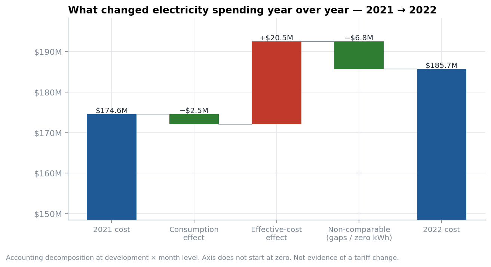
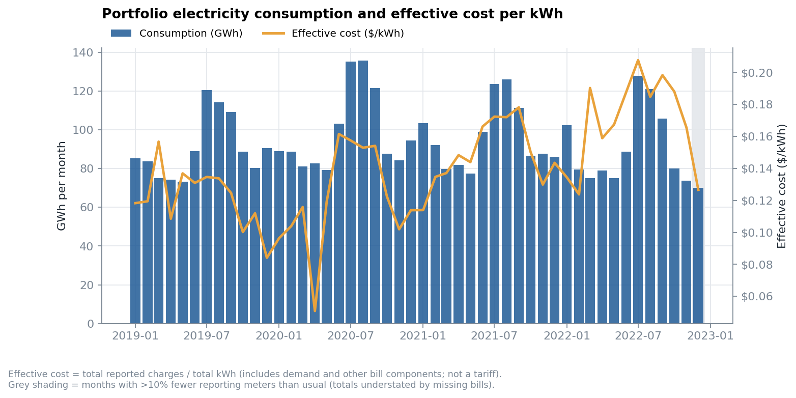
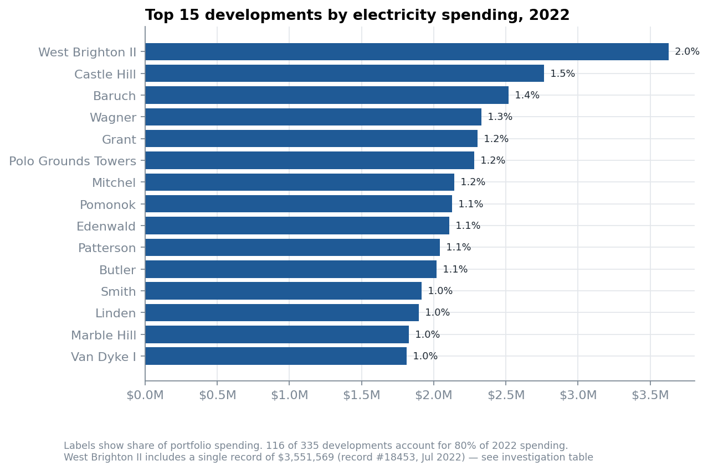
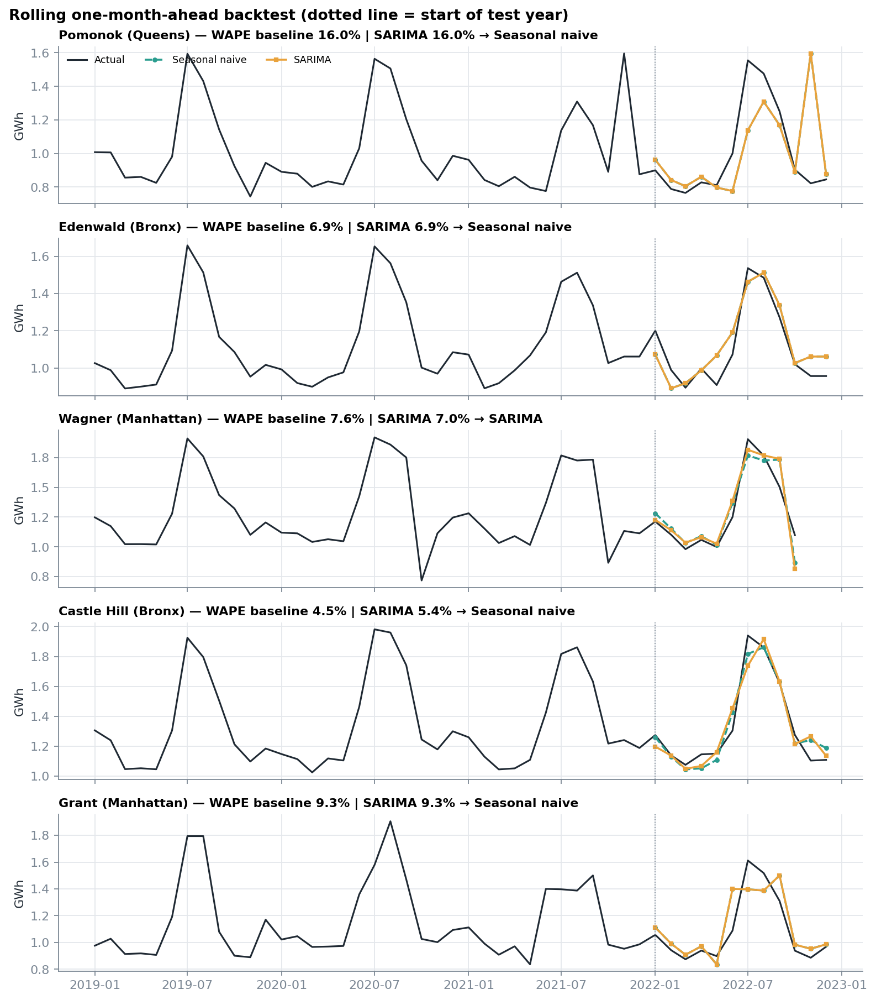
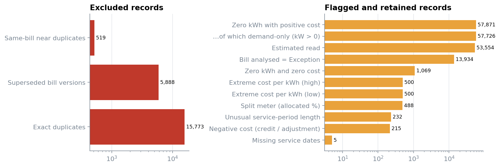
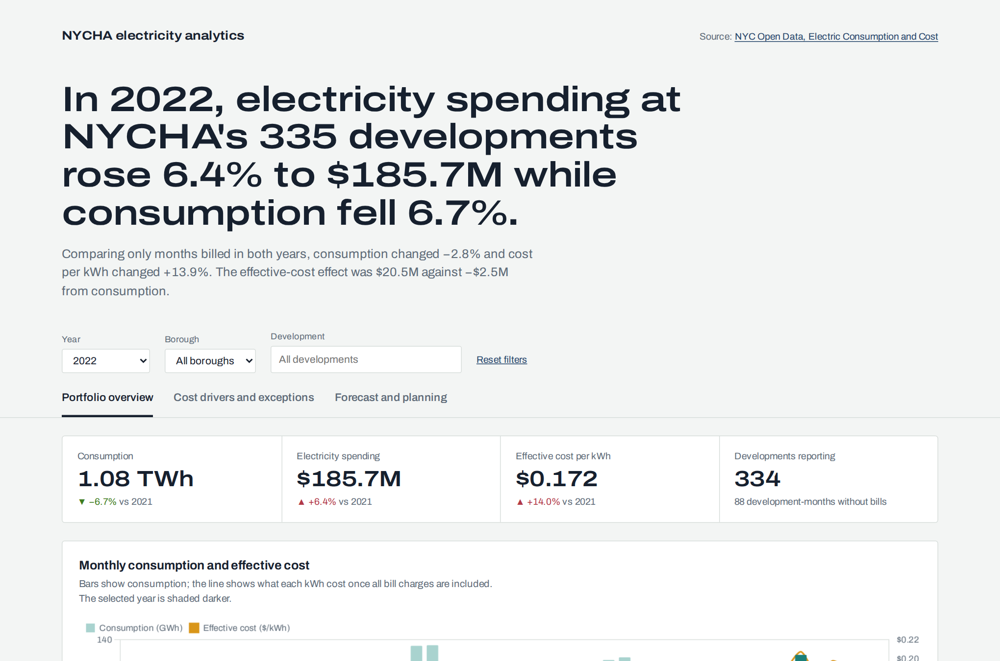
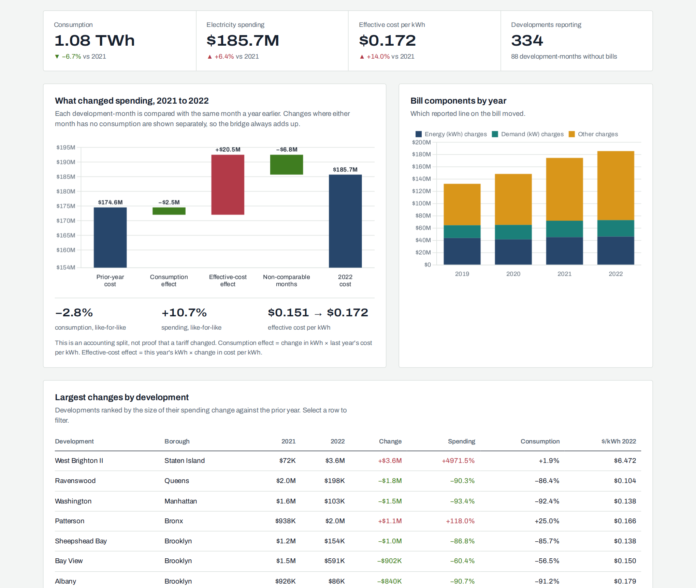
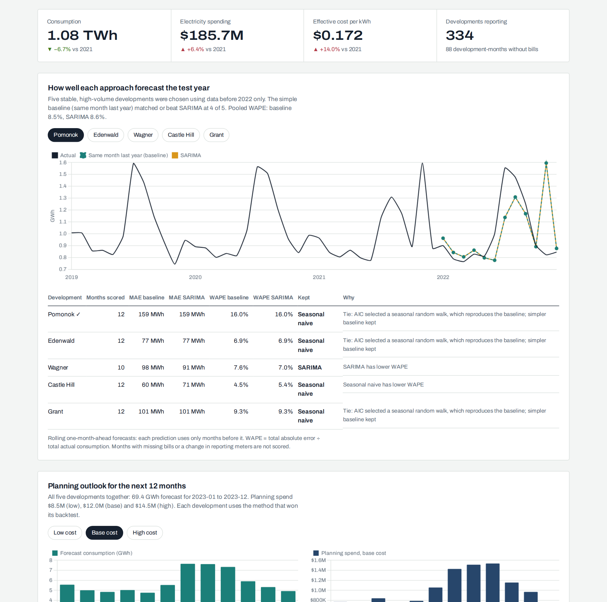
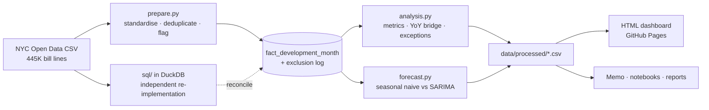

# Electricity Consumption, Cost Drivers & Forecasting — NYC Housing Authority

Facility energy analytics on **NYCHA's public electricity billing records**. The project covers 335 housing
developments over 159K bill lines. It cleans and reconciles the billing data, explains year-over-year
spending changes, flags records that need investigation, and forecasts monthly consumption for planning.

 
 

### [▶ Open the live dashboard](https://sumankumaroraon.github.io/nycha-electricity-analytics/)

**Deliverables:** [Findings memo (PDF)](reports/findings_memo.pdf) ·
[Data-quality report](reports/data_quality_report.md) ·
[Notebooks](notebooks/) · [SQL](sql/) · [Dashboard source](src/nycha_energy/templates/dashboard.html) · [Data dictionary](docs/data_dictionary.md)

> **Data version.** The committed results use the official export covering revenue months **2010-01 → 2023-01**
> (analysis window 2019–2022). The current release runs to Sep 2025. Running
> `python scripts/download_data.py` and then the pipeline reproduces everything on it, with the forecast
> window moving to train 2019–2023 / test 2024 automatically. See [data/raw/SOURCE.md](data/raw/SOURCE.md).

---

## Business question

Where is electricity spending concentrated? What drove the change from one year to the next? Which billing records
need a closer look? What should the team plan for next year?

## Key findings (2022 vs 2021)

| | Reported | Like-for-like* |
|---|---|---|
| Consumption | −6.7% | **−2.8%** |
| Spending | +6.4% ($174.6M → $185.7M) | **+10.7%** |
| Effective cost per kWh | $0.151 → $0.172 | **+14%** |

<sub>*3,927 development-months with kWh reported in both years.</sub>

1. **Cost per kWh, not consumption, drove spending.** The effective-cost effect was **+$20.5M**, against −$2.5M from
   consumption. "Other charges" was the bill component that grew most (+$10.2M).
2. **One record is about a third of the increase.** Record #18453 bills **$3.55M for 69K kWh** (about $51/kWh). The same
   meter bills $4–6K in the months either side. Excluding this record, cost growth falls to +4.4%.
3. **Reporting gaps overstate the demand decline.** Twenty developments have missing months in 2022, and six are
   absent for 11–12 months.
4. **The simple baseline is hard to beat.** Same-month-last-year matched or beat SARIMA at 4 of 5 developments
   (pooled WAPE 8.5% vs 8.6%).

<p align="center"></p>

<details>
<summary><b>More charts</b></summary>

<br>
<br>
<br>

</details>

## Interactive dashboard

A single-page HTML dashboard, hosted free on GitHub Pages from `docs/index.html`. Year, borough and development
filters drive every view. The cost bridge, the like-for-like figures and the exception list are all recomputed
in the browser for whatever you select.

| Page | Answers |
|---|---|
| **Portfolio overview** | Where is spending concentrated? KPIs, monthly consumption and cost per kWh, top developments (click to filter), borough split |
| **Cost drivers and exceptions** | What changed? Year-over-year waterfall, bill components, largest movers, ranked investigation list with source record IDs |
| **Forecast and planning** | What should we plan for? Backtest of baseline vs SARIMA, error table, next-12-month consumption and low/base/high spend |

<p align="center"></p>

<details>
<summary><b>Other pages</b></summary>

<br>

</details>

The pipeline rebuilds the page automatically (`src/nycha_energy/dashboard.py` embeds the processed tables as JSON
into the template), so it never drifts from the analysis. Chart.js and the Archivo font load from CDNs, and there is
no server or build step.

## How it works



**1. Preparation** ([notebook 01](notebooks/01_data_preparation_and_quality.ipynb))

- A row is *one meter line on one bill for one revenue month*. Many meters make up a development, so repeated
  development-month rows are not duplicates. Developments are keyed on `TDS #`, NYCHA's development ID.
- Only two rules exclude records, and each exclusion is logged with a reason:
  - 15,773 **exact duplicates**
  - 6,407 **re-issued bills**: the same meter and service period under a later bill ID
- Everything else is **flagged and kept**:
  - demand-only lines (kWh = 0, kW > 0)
  - credits
  - extreme cost per kWh
  - estimated reads
  - split meters

**2. Metrics and cost drivers** ([notebook 02](notebooks/02_metrics_cost_drivers_and_exceptions.ipynb))

- Effective cost is Σ$ ÷ ΣkWh. It is never an average of ratios, and it is labelled as not a tariff.
- Each development-month is compared with the same month a year earlier:
  consumption effect = ΔQ·R₀, and effective-cost effect = Q₁·ΔR.
- Where a ratio is undefined, the change goes to a *non-comparable* bar, so the bridge always closes.

**3. Exceptions**

- Development-months are screened with robust z-scores for consumption and relative effective cost. Missing months,
  meter-count changes, and spending rises with flat consumption are also flagged.
- Each flag is ranked by dollar magnitude, with evidence and a source `record_id`. Every flag is worded
  "requires investigation" because the dataset cannot establish cause.

**4. Forecasting** ([notebook 03](notebooks/03_forecasting.ipynb))

- Developments are chosen using **training data only**.
- SARIMA order is chosen by AIC on training data. The model is refit for rolling one-month-ahead forecasts across
  the test year and compared with the seasonal-naive baseline on MAE and WAPE. The better method is kept for each
  development.
- Spending outlook = forecast kWh × historical effective-cost scenarios. This is a **planning estimate**, not a bill.

## Validation

| Check | Result |
|---|---|
| Unit tests (`tests/`): dedup rules, flags, decomposition identity, ratio of totals, dashboard data = pipeline totals | 13/13 pass |
| SQL tests (`sql/07`): row flow, uniqueness, components = total, bridge closes, … | 10/10 pass |
| Python ↔ SQL reconciliation (`sql/08`): every development-month, every excluded record | 3/3 pass, 0 mismatches |
| Bill components (kWh + kW + other) = current charges | 0 exceptions |
| Total annual spend vs NYCHA's published ~$180M/yr electricity expense | $175–186M in 2021–22 ✔ |

Full results: [reports/sql_validation_results.md](reports/sql_validation_results.md).

## Reproduce

```bash
git clone https://github.com/sumankumaroraon/nycha-electricity-analytics.git
cd nycha-electricity-analytics
python -m venv .venv && source .venv/bin/activate   # Windows: .venv\Scripts\activate
pip install -r requirements.txt

python scripts/download_data.py              # current release → data/raw/
PYTHONPATH=src python -m nycha_energy.pipeline   # also rebuilds docs/index.html
                                                 # Windows (PowerShell): $env:PYTHONPATH="src"; python -m nycha_energy.pipeline
python scripts/run_sql.py                    # SQL build + validation + reconciliation
python -m pytest -q                          # unit tests
```

Or run `make all`. The pipeline takes about 30 seconds. Open `docs/index.html` in a browser to view the dashboard locally.

### Publish the dashboard

1. Push the repository to GitHub.
2. Go to **Settings → Pages → Build and deployment**. Set Source to *Deploy from a branch*, Branch to `main`, and folder to `/docs`, then save.
3. After about a minute the dashboard is live at `https://sumankumaroraon.github.io/nycha-electricity-analytics/`.
   Each push that updates `docs/index.html` republishes it.

## Repository structure

```
├── src/nycha_energy/     prepare · analysis · forecast · viz · dashboard · pipeline · config
│   └── templates/        dashboard.html (source of the live page)
├── sql/                  01–06 transformations, 07 validation tests, 08 Python reconciliation
├── notebooks/            01 preparation & quality · 02 drivers & exceptions · 03 forecasting
├── data/
│   ├── raw/              SOURCE.md (CSV downloaded, not committed)
│   └── processed/        star schema + analysis outputs (dashboard source)
├── reports/              findings memo, data-quality report, SQL validation, figures
├── docs/                 index.html (live dashboard), preview images, data dictionary
├── scripts/              download, SQL runner, dictionary builder
└── tests/                unit tests (run in GitHub Actions)
```

## Assumptions and limitations

- **Scope.** This is facility energy analytics on housing developments. There are no production volumes, budgets or
  tariff schedules in the data, so the analysis compares against history rather than budget. Nothing is
  reconciled against independent meter readings, because none are available.
- **Re-issued bills.** The highest bill ID is treated as the current version. Summing all versions instead would add
  about 1.8% to window spending. This should be confirmed with the data owner.
- **Effective cost** bundles energy, demand, other charges and adjustments. The decomposition locates the change;
  it does not prove a tariff moved.
- **Revenue month** is the reporting period. Service periods can straddle months.
- **Coverage.** Missing development-months are kept as explicit gaps. Months with incomplete reporting are excluded
  from forecast scoring and isolated in the cost bridge.
- **Forecasting.** The committed run has three training years, one of them 2020, which the pandemic shaped. The
  models are univariate, with no weather or occupancy drivers.
- **Thresholds.** Anomaly and flag thresholds are set in [`config.py`](src/nycha_energy/config.py) and are judgement calls.

## Data and license

Data: [NYC Open Data — Electric Consumption and Cost](https://data.cityofnewyork.us/Housing-Development/Electric-Consumption-And-Cost-2010-Sep-2025-/jr24-e7cr),
published by the NYC Housing Authority under the NYC Open Data Terms of Use. Code: [MIT](LICENSE).

**Author:** Suman Oraon · [GitHub](https://github.com/sumankumaroraon)
